# dsh-genshin-pet 🐾

> **两只原神同人桌宠：哥伦比娅（Columbina）与纳西妲（Nahida）。**
> 她们会赖在 [DeepSeek Harness](https://github.com/deepseek-ai/deepseek-harness) 的桌面上发呆、打瞌睡、被你拎起来晃，
> 也会跟着你敲代码的节奏碎碎念；闲下来乐意陪你聊两句，还记得你上次说过的话。
>
> 代码基于 [PC2005-cloud/dsh-pet](https://github.com/PC2005-cloud/dsh-pet)（MIT）派生，**角色素材不在 MIT 授权范围内**，详见 [LICENSE](./LICENSE)。

<p align="center">
  <a href="https://github.com/Jessicaisleep/dsh-genshin-pet"></a>
  <a href="https://github.com/Jessicaisleep/dsh-genshin-pet/blob/main/LICENSE"></a>
  <a href="https://github.com/PC2005-cloud/dsh-pet"></a>
  
  
</p>

> ⚠️ **素材声明**：本仓库**不包含**任何 API 密钥。
> `dsh-pet/assets/pet/` 下的角色动画权利属于原角色权利人（米哈游 / HoYoverse），不在 MIT 授权范围内；
> 这是**非商业同人作品**，重新分发或商用前请自行确认授权。详见 [LICENSE](./LICENSE)。

装好即得两只可以同时上桌的宠物：待机呼吸、打瞌睡、伸懒腰、左右张望、被你拎起来晃、点击回应——44 段透明动画随时无缝衔接；能跟随 DSH 会话事件切换工作状态动画、按档位播放余额动画 + 头顶气泡、碎碎念与对话聊天、窗口失焦时弹系统通知。能让她们脱离浏览器住上**桌面**（透明置顶小窗），也能自己添加**全新宠物种类**（pet pack）。

**开箱即带两只，各自独立的角色卡与动作池：**

| 宠物 | id | 默认位置 | 动作池 |
| --- | --- | --- | --- |
| 哥伦比娅 · 希珀塞莱尼娅 | `columbina1` | 右上 | 22 段（小动作 / 俏皮 两组分类） |
| 纳西妲 · 小吉祥草王 | `nahida1` | 右下 | 22 段（小动作 / 俏皮 两组分类） |

两只的人设（`whisperPrompt` 角色卡）分别写在 `dsh-pet/assets/pet/columbina-config.json` 与 `nahida-config.json` 里，想改语气直接改那两段文字即可，改完右键「重载配置」即时生效。

---

## 快速开始（安装插件）

装法取决于你在用哪个 DSH：

### 🪟 桌面应用（Electron 版）

直接在应用内「插件管理」页的安装框里填 `dsh-genshin-pet`，不用开终端；需要在终端里操作插件时，用桌面应用自带的那份 CLI。

### 🌐 `dsh web`

> 以下命令都在你的**命令行终端**（PowerShell / CMD 等）中运行。前提是 DSH 环境已就绪：

```sh
# ① 前置要求：确认 Node.js 已安装
node -v

# ② 安装 DSH 启动器与 pnpm（已装可跳过；装完请重新打开终端）
npm install -g @deepseek-ai/dsh pnpm
dsh --version   # 验证 dsh 命令可用

# ③ 安装本插件（web 模式用 --profile web）
dsh plugin --profile web add dsh-genshin-pet
```

装完**重开桌面应用**（`dsh web` 用户则重启 `dsh web`）才生效——运行中的进程持有内存里的旧插件。宠物出现在界面右上角（默认配置角落，可在设置页修改）。

> **兼容性**：本插件当前在 dsh **`0.2.1-rc.2`** 下开发并测试（`dsh --version` 可查看你的版本）。建议使用相同版本；其他版本如遇问题欢迎反馈。

### 从源码安装（clone 本仓库后）

`lib/` 构建产物不入库，clone 后需要先构建再安装：

```sh
# ① clone 本仓库，进入插件目录
git clone https://github.com/Jessicaisleep/dsh-genshin-pet.git
cd dsh-genshin-pet/dsh-pet

# ② 安装依赖
npm install

# ③ 构建（完整 lib：tsdown → lib + 桌面共享核心 + 类型声明）
npm run build       # 必须手动跑一次（克隆后 npm install 不再自动构建）

# ④ 安装到 DSH（file: 指向**插件目录**——上面 cd 进去的那一层，用构建好的 lib）
#    --profile 填实际在用的那个：dsh web → web；
#    桌面应用（Electron 版）改用应用内「插件管理」安装，见上方快速开始
dsh plugin --profile web add file:D:/path/to/dsh-genshin-pet/dsh-pet
```

> 注：`npm run build`（即 `scripts/prepare.js`）才产出**完整可安装**的 lib——除 tsdown 构建外还构建桌面共享核心（`shared-core.js`）、生成类型声明并收敛发布 `files` 清单；裸 `tsdown` 构建会缺桌面运行时与类型。发布与打包（`npm publish` / `npm pack`）时由 `prepack` 自动调用它，克隆仓库后需手动跑一次。

### 安装后你会看到什么

默认配置是 `display: "both"`（浏览器与桌面都显示），所以重开 DSH 之后会依次出现两处，不必手动开：

1. **浏览器端先出现。** 宠物落在界面右上角（默认角落，设置页可改），此时桌面上还是空的。
2. **宿主自动补桌面运行时。** 本机没有 Electron 时，插件会自己下载一份（落在 `~/.dsh/electron`，同一版本只下一次；默认走 npmmirror 镜像）。进度直接打在 DSH 的控制台里，形如：

   ```
   [dsh-pet] Electron not found, downloading to <用户目录>/.dsh/electron/electron.exe ...
   [dsh-pet] Electron not found, downloading v43.3.0 (win32-x64) ...
   [dsh-pet] downloading 42.3MB / 104.1MB
   [dsh-pet] download complete (37.5s), extracting to <用户目录>/.dsh/electron ...
   ```

   这一步在**后台**进行，浏览器里的宠物照常可用；要等多久取决于网速（几十秒到几分钟），期间不用管它。
3. **桌面端随后出现。** 解压完自动拉起桌面 Helper，同一只宠物以透明窗形式落到桌面上——**此时屏幕上一共两只**：浏览器里一只、桌面上那只，共用同一份配置与同一套动画。
4. **想只留一只。** 两条路都行，改完即时生效：
   - **设置页**：选中该宠物 →「显示位置」下拉框 → 仅浏览器 / 仅桌面 / 两者都显示 / 都不显示；
   - **宠物右键**：菜单里的「显示位置」子菜单 → 仅网页 / 仅桌面 / 两者 / 都不（不用回设置页）。

> 已经装过 Electron（或设了 `DSH_PET_ELECTRON_PATH` 指向现成可执行文件）时，第 2 步会跳过，桌面端几乎立刻出现。下载失败**只影响桌面模式**：控制台会给出提示，浏览器里的宠物不受影响；网络受限时可以设 `DSH_PET_ELECTRON_MIRROR` 换镜像、`DSH_PET_ELECTRON_VERSION` 指定版本，重启后再试。

## 插件功能

- **纯粹的桌宠**：不做天气、监控等无关功能，不碰 DSH 内核；可选能力只有下面这些（余额 / 碎碎念 / 对话 / 工作状态 / 系统通知）
- **动画链**：每个动画（含待机）播完即按权重选下一个（默认 idle 10 / turn 5 / move 5 + 分类权重，`config.jsonc` 可调），首尾相接
- **事件动画**：余额 / 碎碎念 / 工作状态按档位触发专属动画；档位支持候选数组——触发时档内随机、循环播放自动轮换，避免连播同一段
- **多开**：同时显示多个宠物，各自独立大小与位置（设置页「桌宠配置」添加/删除）
- **屏幕漫游**：朝朝向方向行走，先探测空间、不走出屏幕（多屏按各屏边界判定；设置页「锁定在当前屏幕」开启后只在当前所在那块屏内走）
- **点击 / 拖拽 / 甩抛**：点击有回应动画并 Q 弹挤压；拖拽过阻尼弹簧跟手，甩出即抛物线飞行、屏幕边缘反弹、落地摩擦停稳并 Q 弹一下；温柔放下原地停住；两端同一套纯函数物理与挤压曲线（`dsh-pet/src/shared/physics.ts`）
- **右键菜单**：「动作 → 分类 → 具体动画」任意点播（移动类动画点播会真实行走一段）；工具项——浏览器端：碎碎念 / 对话 / 回到初始位置；桌面端：+ 打开网站、查看余额（余额启用时显示）、重载配置（改完配置文件直接右键重载全部桌面宠物，不必回设置页点保存）
- **「打开网站」按宿主自动分派**：宠物宿主是 **DSH 桌面应用**时，该项自动变成「打开 DeepSeek Harness」——用应用自注册的 `dsh://open` 协议把桌面应用主窗口唤到前台（已运行则前置、未运行则拉起）；宿主是 `dsh web` / 独立模式时，仍是系统默认浏览器打开站点
- **朝向与落地**：全部动画可镜像（可朝左 / 朝右）；脚底线统一，宠物始终站在地面上
- **流畅切换**：双缓冲交叉淡入，切换无空白帧
- **余额展示**：按已用百分比分档播余额动画 + 头顶联想气泡（10 秒自动消失）；DeepSeek 显示账户余额，OpenCode Zen Go 与 Command Code 显示最紧迫的一个额度窗口；**未登记余额接口的服务商改为弹文字说明**（不静默）；按宠物独立开关
- **碎碎念与对话**：碎碎念按周期自动生成一句（说话动画 + 气泡，也可手动触发）；对话在右键弹输入框与宠物聊天，记忆持久化（浏览器 / 桌面共享同一份）
- **工作状态联动**：监听 DSH 会话事件，切「思考 / 工作 / 整理 / 等待 / 成功 / 出错」档位动画 + 常驻气泡；目标多轮任务只在真正收尾轮庆祝
- **系统通知**：窗口失焦时弹系统 toast（对话完成 / 生成失败 / 输出截断 / 权限申请 / 用户选择）
- **桌面模式（可选）**：每只宠物开一个独立透明置顶局部小窗，与浏览器严格同行为、共用同一份素材与纯逻辑（见下节）
- **pet pack（额外宠物种类）**：`pet/` 下建 `种类名-config.json` + `种类名-animation/` 即新增独立动画池与素材的全新种类，多实例共享素材（见 [CONFIG.md](CONFIG.md) 的「方式四」）
- **自定义动画**：往 `main-animation/webm/` 放 VP9-Alpha 的 `.webm` 即为新动画，优先于包内素材
- **无障碍**：支持 `prefers-reduced-motion`（减少动效时跳过 Q 弹挤压与淡入切换）

## 🔌 对外接口（供其他插件调用）

桌宠不只自己玩，也**对外开放两条调用通道**，让别的插件或脚本能驱动它、读它的状态。

- **能做什么**：让它说一句指定的话、播一段指定动画、与它对话；读它当前说的话、工作状态、系统通知与余额
- **为什么开放**：桌宠不该只是个摆设——比如一个「女仆」插件巡检验完想说句话，就能让桌宠当它的「实体」开口；也方便任何人基于它做二次开发
- **通道一 · HTTP**：挂在 DSH 自己的 Web 服务上（前缀 `/dsh-pet-7340`，只监听本机、无鉴权），跨进程、脚本可直接调。动作类接口只回 `{ok}`，数据统一从 `GET /state` 读
- **通道二 · Cordis 服务**：客户端半侧在 DSH web 页面内注册，同页客户端插件用 `ctx.get('petApi7340')` 直接取，零网络、零端口；只在该页面实例内有效，方法与返回见 [`CORDIS.md`](CORDIS.md)

相关文件（HTTP 与 Cordis 各一套）：

- [`API.md`](API.md) —— HTTP 接口一览（每个接口一句话，功能预览）
- [`openapi.yaml`](openapi.yaml) —— 完整契约（OpenAPI 3.1，可直接导入 Swagger UI / Postman）
- [`CORDIS.md`](CORDIS.md) —— 对外 Cordis 服务（客户端半侧，页面内 `ctx.get('petApi7340')`，不走网络）
- [`tools/api-tester.html`](tools/api-tester.html) —— HTTP 侧示例：桌宠控制台，扮演第三方消费方，可直观试用（`node tools/api-tester.cjs` 启动）
- [`tools/cordis-probe`](tools/cordis-probe/README.md) —— Cordis 侧示例：扮演同页客户端插件，用 `ctx.get()` 消费服务

扩展做出来后欢迎分享：统一收录在 [PC2005-cloud/petE](https://github.com/PC2005-cloud/petE)——本项目的扩展收录仓库，每个扩展占一个目录、元信息写在 `plugin.json`，列表由流水线生成。想把自己的加进去，按仓库里的 `CONTRIBUTING.md` 提 PR 即可。安装：`dsh plugin --profile web add "github:PC2005-cloud/petE#path:/<扩展目录>"`。收录不代表对功能或安全性的审核，安装前请自行阅读代码。

## 兼容性

- **操作系统**：Windows / Linux / macOS 三端均可运行——浏览器 overlay 与桌面模式（Electron 透明置顶窗）行为完全一致；Electron 按平台自动探测/下载（`electron.exe` / `Electron.app` / linux 单文件），无需手动安装
- **无头 / 无桌面环境**：支持 Linux headless 等无图形会话——桌面模式自动检测显示环境（Linux 无 `DISPLAY` / `WAYLAND_DISPLAY` 时判定无显示、跳过桌面窗口，仅日志告警），浏览器 overlay 不受影响
- **浏览器**：浏览器 overlay 兼容 **Chromium 内核（Chrome / Edge 等）与 Firefox**——透明动画依赖 VP9-Alpha webm，三者均已实测透明确认；**不支持 Safari**（macOS 不认 webm alpha，透明渲染为黑底）——macOS 用 `.mov` 素材（GitHub Release `assets-mov`），下载放入即可（见「②.5 Safari/HEVC 兼容素材」）
- **多显示器**：支持多屏环境——跨屏漫游/抛掷以各屏工作区为界，异构缩放（各屏 DPI 不同）、任务栏条带、屏幕之间空洞均正确判定（横屏 / 竖屏 / 上下叠放皆可）；设置页「锁定在当前屏幕」可让宠物（抛掷与漫游）只在当前所在那块屏内活动

## 🪟 桌面模式（可选，脱离浏览器）

插件内建**双模式**：安装后默认会拉起**独立透明置顶小窗**——为每只桌面宠物各开一个局部窗口（跟随宠物移动，**不铺满屏幕**），与浏览器 overlay 严格同行为、功能完全对齐：

- **依赖**：首次启动自动探测/下载 Electron（`~/.dsh/electron/`，也可 `cd dsh-pet && npm run ensure:electron` 手动触发）；缺失时仅日志告警，不影响浏览器形态
- **开关 = 每只宠物的必填字段 `display`**：`web` = 仅浏览器 / `desktop` = 仅桌面 / `both` = 两者 / `none` = 都不显示；桌面模式渲染 display 含 desktop 的**全部**宠物（多开同屏，与浏览器一致），设置页「桌宠配置」编辑即时生效
- 桌面端数据走独立进程管道，不依赖 DSH 的 HTTP 路由，不受 web 访问闸门影响
- 本地调试：`cd dsh-pet && npm run start:desktop -- http://127.0.0.1:3080/dsh-pet-7340/config`（无宿主时自动回落 HTTP 路径）

## 🧍 两种形态：纯插件 / 纯独立（2026-10-27 起彻底分开）

**同一份源码，两个互不包含的发布物。** 从上游 0.3.9 起「插件的副产物也能当独立版跑」这条路已封掉（本包的版本线从 `0.1.0` 起，与上游各自独立）：

| | 插件形态 | 独立形态 |
| --- | --- | --- |
| 装法 | `dsh plugin add dsh-genshin-pet`（或插件管理页填 `dsh-genshin-pet`） | 下载 zip，双击 `Start-Pet.vbs` |
| 跑在哪 | DSH 里（浏览器 overlay + 可选桌面小窗） | 自己的 Electron 进程，不依赖 DSH |
| 发布物 | npm 包，**只含插件半边** | `dist-app\win-unpacked` 打的绿色包 |
| 数据目录 | `$DSH_HOME/dsh-pet/` | `<程序目录>\data\dsh-pet/` |
| 人设 / 记忆 / 上下文 | 各自独立，**不互通**（要复用就手动拷 `pet/` 与 `memory.json`） | 同左 |

**两种形态不能同时运行。** 它们各有自己的桌面窗口与托盘，同时跑会出现两只宠叠在一起、
两个一模一样的托盘图标。启动时会检查 `%APPDATA%\dsh-pet\running-form.json`，
发现另一个形态在跑就弹一句「XX 正在运行，本次启动已取消」然后正常退出
（实现见 `runtime/electron-helper/form-lock.js`）。想换形态：先从托盘退出当前那只。

> 上游早期版本（≤0.3.8）的 `dsh-pet-standalone` CLI（`npm i -g dsh-pet && dsh-pet-standalone`）
> **已移除**：那是「用插件包跑独立形态」的旧路，与两形态分离相悖。独立形态现在只以
> Electron 应用分发，功能更完整（有窗口、托盘、拖拽，而不是只开一个 HTTP 服务）。

## ⚙️ 余额展示（Balance）

按 `eventsRefreshSec.balance`（秒）周期拉取当前服务商的余额/用量数据，每次刷新按档位触发一次余额动画，并在宠物头顶弹出**联想气泡**（随宠物大小等比缩放，10 秒自动消失）：

- **DeepSeek 官方（`deepseek-official`）**：气泡显示账户余额（如 `余额 ¥8.79`）；余额按 ¥20 满额折算成已用百分比，分 6 档播放动画（钱袋满溢 → 金袋叮当 → 钱袋如常 → 数金皱眉 → 袋空如洗 → 分文不剩）
- **OpenCode Zen Go（`opencode-go`）**：气泡显示 5h/周/月 三个额度窗口中最先告急的一个（如 `周额度已用 88%` / `2.5 天重置`），同样按已用百分比分档
- **Command Code（`commandcode`，含 GOAT 等套餐）**：气泡显示 5h/周/月 三个额度窗口中最先告急的一个（与 opencode 同一口径：剩余额度最少者，通常先报 5h）；套餐无窗口限制时只报月度窗
- **暂不支持的服务商**：未登记余额接口的服务商**不播档位动画，改为弹一句文字说明**——第一行「当前服务商暂不支持余额查询」，第二行报出当前 provider id（便于自查）；缺凭证 / 抓取失败同理（原因写在第二行）。自动轮询只在**原因变化**时弹一次（不反复打扰），手动 `/balance` 或桌面右键「查看余额」则每次都会弹
- **按宠物开关**：`pets[i].balanceEnabled`（必填布尔）控制该宠物是否触发余额动画/显示气泡
- **所需凭据**：对应 provider 的 API key（`deepseek-official` → `DEEPSEEK_API_KEY`；`opencode-go` → `OPENCODE_GO_API_KEY`；`commandcode` → `COMMANDCODE_API_KEY`），在 DSH 凭据中配置后启用；未匹配的服务商不触发动画，改为弹上面的文字说明气泡

## ⚙️ 碎碎念与对话

- **碎碎念**：`pets[i].whisperEnabled` 开启后，按 `eventsRefreshSec.whisper`（秒，默认 300）周期自动生成一句——每只宠物独立周期、独立文案；触发时随机抽 `events.whisper` 动画 + 头顶说话气泡（10 秒消失）。默认开启
- **手动触发**：右键菜单「碎碎念」随时来一句——不受 `whisperEnabled` 门控（该字段只关自动周期轮询）
- **对话**：右键菜单「对话」或 `/chat` 命令打开输入框，与宠物聊天——回复走碎碎念同款展示（说话动画 + 气泡）；记忆持久化在 `$DSH_HOME/dsh-pet/memory.json`，浏览器与桌面共享同一份；多宠物时先用 `/pet` 选择对话目标

## ⚙️ 工作状态联动（Work Status）

`pets[i].workStatusEnabled` 开启后，宠物跟随 DSH 会话活动切「思考 / 工作 / 整理 / 等待 / 成功 / 出错」六档动画 + 头顶气泡：非终态动画循环播、气泡常驻；成功 / 出错播一遍、气泡 10 秒自动收起。

- **档位动画**：`animations.events.workStatus` 数组，索引即档位（勿在中间插入新档，只可追加末尾）
- **气泡文案**：`workStatusTexts` 每档可配多句随机，任务详情（todo）优先
- **档位候选数组**：任意档位槽位可写 `string | string[]`——数组 = 档内随机抽 1，循环播放自动轮换、避免连播同一段（余额 / 碎碎念档位同样适用）

## ⚙️ 配置（大小 / 位置 / 多开）

设置页可改大小、位置、边距、显示位置、余额开关、多开与物理参数；配置文件则可以任意自由配置（动画池、播放权重、事件动画、刷新周期……）。

三种配置途径与「pet pack 额外宠物种类」的完整说明见 **[CONFIG.md](CONFIG.md)**。

## 效果预览

下面这 44 段就是插件实际播放的动画，源文件是 `dsh-pet/assets/pet/<素材根>-animation/` 下的 VP9-alpha `.webm`（640×360，透明背景）。这里转成 GIF 方便在 GitHub 里直接看——**GIF 里的透明区显示成页面底色，插件里播放是真透明**。

两只角色各有 22 段：19 段同名同义（共用同一套动作设计），3 段碎碎念是各自专属。

### 哥伦比娅 · 希珀塞莱尼娅（`columbina1`，默认右上）

**待机与移动（8 段）** —— `animations.idle` / `turn` / `moves`

<p>
  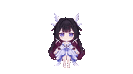
  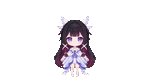
  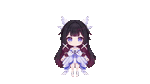
  
  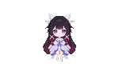
  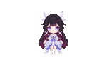
  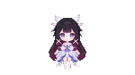
  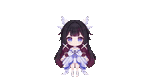
</p>

**被点到 / 被拎起（6 段）** —— `animations.clicks` / `drag` / 分类「俏皮」

<p>
  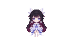
  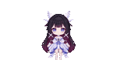
  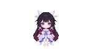
  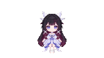
  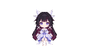
  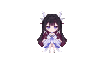
</p>

**小动作（5 段）** —— 分类「小动作」

<p>
  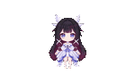
  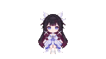
  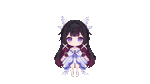
  
  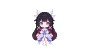
</p>

**碎碎念（3 段，本角色专属）** —— `animations.events.whisper`

<p>
  
  
  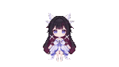
</p>

### 纳西妲 · 小吉祥草王（`nahida1`，默认右下）

**待机与移动（8 段）**

<p>
  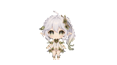
  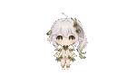
  
  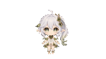
  
  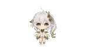
  
  
</p>

**被点到 / 被拎起（6 段）**

<p>
  
  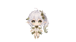
  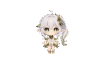
  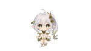
  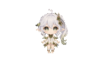
  
</p>

**小动作（5 段）**

<p>
  
  
  
  
  
</p>

**碎碎念（3 段，本角色专属）**

<p>
  
  
  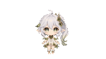
</p>

> 想换成自己的动画：把同名 VP9-alpha `.webm` 放进 `$DSH_HOME/dsh-pet/pet/<素材根>-animation/`（用户层优先于包内），或在 `*-config.json` 里改 `animations` 引用别的名字。做法见 [MAKE-YOUR-OWN-PET.md](MAKE-YOUR-OWN-PET.md)。

## 从零生成你自己的宠物

AI 提示词 → 绿幕视频 → 透明动画 → 插件，换角色、换动作、换风格，全流程可复现。

完整步骤见 **[MAKE-YOUR-OWN-PET.md](MAKE-YOUR-OWN-PET.md)**（提示词配方、素材链、Safari 兼容、发布）。这份指南沿用上游 dsh-pet 的素材流水线，其中 `assets/webm/` 这类上游目录在本仓库已改为 `assets/pet/<素材根>-animation/`，脚本路径请按本仓库结构对照。

## 项目结构

只列代码与发布相关目录；素材链的 video / scripts / step / pr 见 [MAKE-YOUR-OWN-PET.md](MAKE-YOUR-OWN-PET.md) 的 ② 章节（gitignore 的本地目录不列）：

```
├── README.md  MAKE-YOUR-OWN-PET.md  CONFIG.md  API.md  CORDIS.md  openapi.yaml   # 说明 / 宠物制作指南 / 配置 / HTTP 接口 / Cordis 服务 / OpenAPI 规范
├── prompts/           # ① 动画生成提示词配方（绿幕规范 + 按秒分解）
├── assets/            # 仓库展示用：assets/preview/ 两只角色的效果 GIF（不属于插件素材）
├── tools/             # 开发工具：API 调试页、cordis-probe mock 服务商、DPI 探针
├── .github/workflows/ # CI：Safari/HEVC 转码流水线（macOS runner，手动触发 → 发布 assets-mov Release）
├── dsh-pet/           # ③ 插件（可独立 npm 发布，包名 dsh-genshin-pet）
│   ├── src/
│   │   ├── host/       # 宿主半侧：配置 / 路由 / 余额 / 工作状态
│   │   ├── client/     # 浏览器半侧：宠物渲染 / 动画链 / 设置页
│   │   ├── shared/     # 双端共用纯逻辑（物理 / 菜单 / 取数）
│   │   ├── standalone/ # 独立形态的服务/配置/AI 层（与 host 共用，不随插件发布）
│   │   └── app/        # 独立形态主进程（Electron，不随插件发布）
│   ├── lib/            # 构建产物（npm run build 生成，不入库）
│   ├── runtime/        # 桌面模式运行壳（Electron 透明窗）
│   ├── assets/         # pet/（两只角色：*-config.json + *-animation/*.webm）/ 字体 / 图标 / 音效 / 全局默认 config.jsonc
│   └── scripts/        # 构建、发布与开发脚本
└── LICENSE             # MIT（含素材排除声明）
```

## 💬 反馈与发版节奏

欢迎提 [issue](https://github.com/Jessicaisleep/dsh-genshin-pet/issues) 与 PR——bug、体验问题随时反馈。**新功能请先开 issue** 说明使用场景，由维护者判断是否实现、以及放在插件本体还是作为第三方扩展，不要在确认前直接提交实现 PR。

- **报 bug 时请带上**：插件版本、`dsh` 版本、操作系统、复现步骤（有日志或截图更好）。
- **上游的通用问题**：本包的功能主体派生自 [PC2005-cloud/dsh-pet](https://github.com/PC2005-cloud/dsh-pet)，与两只角色无关的通用问题（动画链、物理、Electron 桌面窗口等）也可以去上游翻 [提交记录](https://github.com/PC2005-cloud/dsh-pet/commits/main)，很可能已经修好。
- **发版**：本包自己的版本号从 `0.1.0` 起，与上游 `dsh-pet` 的版本线**各自独立**，不要拿两边的版本号对比新旧。

## 许可

- **代码**：MIT。`LICENSE` 里同时保留了上游 `PC2005-cloud/dsh-pet` 的版权行与派生部分署名，两者都要遵守。
- **角色形象与动画素材**（`dsh-pet/assets/pet/` 下的全部 `.webm` 与本仓库的预览 GIF）：**不在 MIT 授权范围内**。角色形象（哥伦比娅 / 纳西妲）及其原始素材的权利属于原权利人（米哈游 / HoYoverse），本仓库只是把它们做成桌宠动画的**非商业同人作品**。重新分发、改造或任何形式的商业化之前，请自行确认你获得了相应授权。
- **字体**：`dsh-pet/assets/fonts/` 下的第三方字体按各自许可证分发，不适用 MIT。
- **上游二创约定**：上游 dsh-pet 要求基于它的衍生作品在公开渠道附上原作者仓库地址，因此本 README 与 `LICENSE` 都保留 <https://github.com/PC2005-cloud/dsh-pet>。
- **不含密钥**：本仓库不含任何 API key（`.credentials.yaml` / `.env` / `standalone-ai.json` / `memory.json` / `logs.txt` 均被 `.gitignore` 排除）。